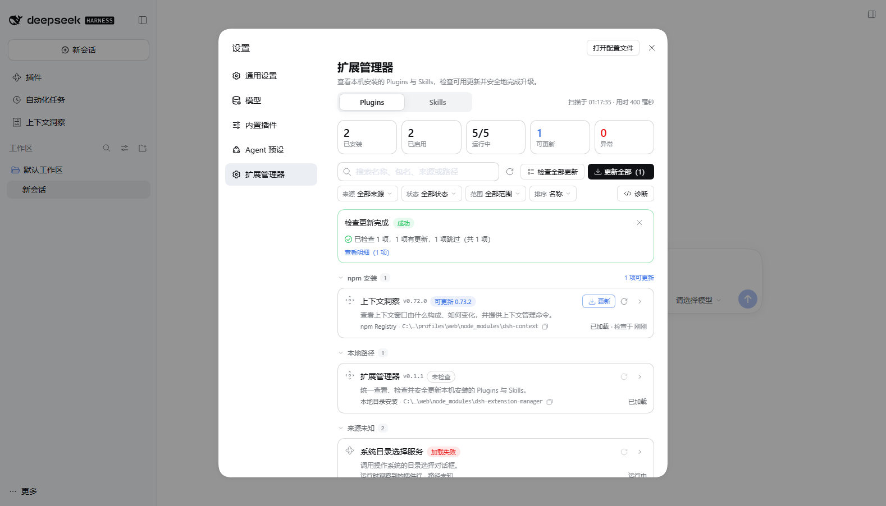
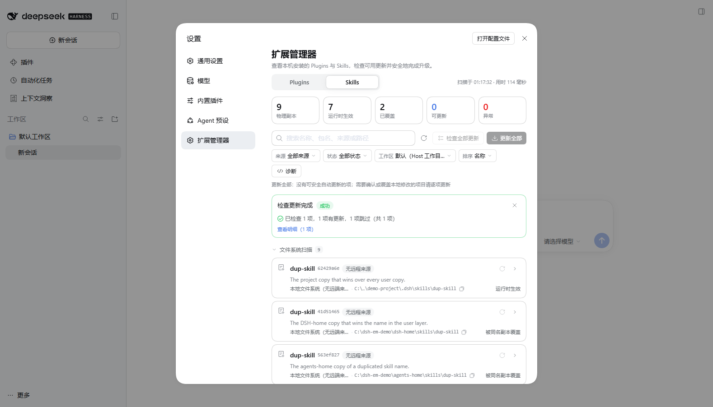
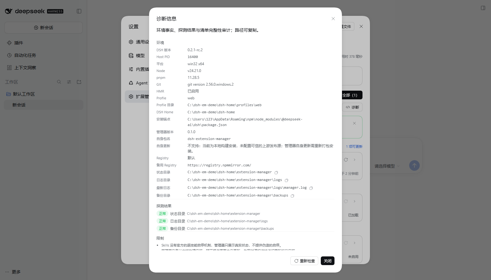

# DSH Extension Manager

[](https://github.com/NewBeeJack/dsh-extension-manager/actions/workflows/ci.yml)
[](https://www.npmjs.com/package/dsh-extension-manager)
[](LICENSE)
[](https://github.com/deepseek-ai/deepseek-harness)
[](package.json)

A native **DSH (DeepSeek Harness)** plugin that inventories, checks and safely updates the **Plugins** and **Skills** installed on your machine — from one page inside the DSH Web GUI.

It is a real settings section, not a standalone site: **Settings → 扩展管理器 (Extension Manager)**. All data comes from Host-side reads of the plugin manager, the live Skills registry, profile manifests, pnpm lockfiles, npm registries, GitHub and `git ls-remote`. Updates run as durable transactions with verified backups and automatic rollback.



## Features

- **One page, two inventories.** A segmented **Plugins / Skills** control, five-cell stats, source groups, search, status/source filters, sorting, workspace-aware Skills scanning, details dialogs and per-record update history.
- **Plugins**: installed third-party bundles, the Loader rows they contribute, runtime loaded/failed state, install spec/version/provenance, and read-only views of other readable profiles. DSH-shipped components are intentionally excluded — DSH's own **Built-in plugins** page manages them.
- **Skills**: physical copies vs. runtime-visible skills, same-name shadowing, unmanaged roots, invocation policy, provenance and local-modification state.
- **Update checks**: npm registry lookup with private-registry isolation and DSH-compatibility evaluation; git installs through `git ls-remote`; Skills through GitHub trees API and `.skill-lock.json` folder hashes. Failures and rate limits are reported, never rendered as “up to date”.
- **Safe updates**: plan → confirm → verified backup → download/stage → install → read-back validation; failures roll back automatically. One update at a time (concurrent requests get `409 update-busy`), durable history and backup retention.
- **Diagnostics** dialog: environment facts, registries/proxy, writability probes, completeness audit for both inventories and the current limitations list.
- **Theme-native UI**: light/dark themes, DSH design tokens, responsive layout, symmetric dialog spacing with 24px top/bottom breathing room.

| Skills page | Diagnostics |
| --- | --- |
|  |  |

## What's new in 0.4.3

- **V3 visual refresh**: soft semantic stat cards, real package icons with local puzzle/document fallbacks, three-layer extension cards with full install-directory copy, compact check-result summary with partial-failure warning, header diagnostics and a measured single-row toolbar.
- **V2.1 fixes**: Plugins and Skills each own their task result panel, details-expanded state and dismissed state; group headers remain collapsible with filters/sorting; list rows keep only one “view details” arrow (details and batch update retain the existing actions).
- **Toolbar V2**: search, filter, refresh-list, check-updates and the conditional black update-all are measured against the real content width; they stay on one line when their natural widths fit, keep labels unwrapped and use a common 34 px control height. The update-all count comes from the existing read-only batch plan, and the button stays hidden until a complete successful check.
- **One-screen detail dialogs**: Plugins and Skills now open with only basic info, the project repository, the installation location and update status. All former technical sections, diagnostics, update history, contribution rows and same-name copy details are behind a default-collapsed “高级信息与诊断”.
- **Traceable repository links**: a read-only resolver handles package.json repository declarations, git/GitHub install provenance, GitHub HTTPS/SSH/shorthand spellings, monorepo subdirectories and honest non-link states. It never changes update sources and never guesses a repository from a name.
- **Preserved capabilities**: full paths remain copyable, update check/update actions, diagnostics, history and every previous technical field remain available.
- The V5 foundation (three stats, compact toolbar/filter panel, UpdateCoordinator, Skills scope/conflicts, inventory cache and on-demand rendering) is unchanged.

> 0.3.0 is a local build only; it has **not** been published to npm or GitHub. Install the local tarball described below.

## Requirements

| Item | Requirement |
| --- | --- |
| DSH | 0.2.1-rc.2 (compatibility baseline) |
| Node.js | `>=22.19.0` (Node 24 verified) |
| pnpm | provided through `dsh plugin` |
| git | optional — required only for git-installed plugins/skills |
| Network | npm registry and/or GitHub; `HTTPS_PROXY` / `HTTP_PROXY` / `NO_PROXY` and `GITHUB_TOKEN` / `GH_TOKEN` are honored |

## Installation

### From the local V6 tarball

```bash
dsh plugin --profile web add "<absolute path>/dsh-extension-manager-0.4.3.tgz"
```

Then enable the bundle. `dsh plugin` forwards to pnpm and does **not** select the bundle, so add `"dsh-extension-manager"` to `dsh.profile.bundles` in `$DSH_HOME/profiles/web/package.json`, or enable it from the DSH plugin manager UI. Restart DSH (or let HMR recompose the profile). Open **Settings → 扩展管理器**.

The npm package on the public registry is still the earlier 0.1.1 release; no 0.3.0 package or release exists remotely.

### From source

```bash
npm ci
npm run build          # lib/index.js (Host ESM) + lib/client.js (Web client)
npm test               # 126 unit tests
npm pack               # dsh-extension-manager-0.4.3.tgz
```

Then install the packed tarball as above. For iterative development use `dsh plugin --profile web add "link:<path-to-checkout>"` and rebuild; the client bundle hot-swaps and `node scripts/dev/reload-host.mjs` can trigger a Host recomposition.

## Using the page

Open **Settings → 扩展管理器**. The toolbar provides search, source/status/range filters, a Skills workspace picker, refresh, diagnostics, **check all updates** and **update all safe updates (N)**.

- **Check** is per item or batch; results are cached for 5 minutes and recorded in `state.json`.
- **Update** always builds a plan first. Batch mode only auto-runs safe entries; items with local modifications, prerelease-only or git sources are listed for explicit per-item confirmation (with a risk checkbox and optional overwrite confirmation).
- The task panel streams progress; when a restart is required the page shows a pending-restart banner.
- Everything writable is addressed by inventory id and resolved server-side; client-supplied paths are never trusted.

## Update safety

```
PREFLIGHT → BACKUP → DOWNLOAD → STAGE → INSTALL → VALIDATE → PENDING_RESTART / VERIFIED
failures: FAILED → RECOVERY → RECOVERED / RECOVERY_REQUIRED
```

- The install directory plus profile manifests (`package.json`, `pnpm-lock.yaml`, `pnpm-workspace.yaml`, `cordis.patch.yml`, `compatibility.json`) are hash-verified before any destructive step.
- Validation reads `listBundles()` back and checks the lockfile commit; a zero exit code alone is not success.
- Backups live under `$DSH_HOME/extension-manager/backups/<txid>/`; the newest 20 transactions are kept (open transactions are never pruned). Logs are JSON Lines with credential masking.
- The manager never updates itself, never restarts DSH, and never writes to other profiles. DSH-shipped components are not listed or updated here; use DSH's **Built-in plugins** page for those.

## Compatibility and limitations

- Baseline: **DSH 0.2.1-rc.2**. Uses `ctx.pluginManager`, `ctx.skills`, `ctx.webServer`, `profileContext`, `ctx.connection.admit`, optional `loader`/`configEditor`/`workspaceRegistry`/`hmr`.
- Other profiles are read-only. DSH-shipped components are excluded from this page and follow the DSH release (manage them in **Built-in plugins**).
- Git-installed plugin updates are single-item, explicitly confirmed, and cannot fully roll back install-script side effects.
- Skills auto-update supports GitHub-backed directory skills only; flat-file skills and directories containing symlinks are refused.
- No per-skill enable/disable (DSH has no such mechanism), no in-page self-update, no DSH restart from the page, no “cancel running update” button.
- Verified on Windows; POSIX code paths exist but are untested.

The full limitation list and detailed rules are in [README.zh.md](README.zh.md) §9 (Chinese; a complete user/maintenance guide).

## Development

```bash
npm ci
npm run typecheck
npm test
npm run build
```

- `test/*.test.ts` — 126 unit tests (native Node TS runner, no build step): registry/git/lockfile parsing, compatibility, transaction state machine, backups, archive extraction, rollback and crash recovery.
- **Isolated acceptance environment** (never touches your real `~/.dsh` / `~/.agents`):

  ```bash
  node scripts/test-env/setup.mjs [root]
  node scripts/test-env/start.mjs --port 3099 [--root <root>]
  node scripts/test-env/run-all.mjs
  node scripts/test-env/stop.mjs
  ```

  The scenarios cover npm/git/Skills updates, rollback, local-modification conflicts, batch/concurrency, interrupted-install recovery and Windows file locks.
- **Dialog layout regression** (CDP, headless Chrome):

  ```bash
  node scripts/dev/verify-dialog-layout.mjs --url "http://127.0.0.1:3080/?token=..." \
    --cookie scripts/dev/cookie.json --sizes "1920x1080,1536x864,1366x768,1093x614,911x512,683x384"
  ```

  It opens every dialog, asserts 24px/24px top/bottom spacing, no footer overlap, scrollable body with a readable last line, multiple viewport sizes and dark mode. See [docs/dialog-layout.md](docs/dialog-layout.md).

## Performance snapshot (local, V5)

The list switches to windowed rendering above 100 visible rows, using the preview data set (`?emFixture=1&emRows=N`) on the local machine:

| Rows in inventory | Mounted `.em-row` | Total DOM nodes | Manager open | Search |
| --- | --- | --- | --- | --- |
| 21 | 21 | ~1.4k | 252 ms | 4 ms |
| 61 | 61 | ~2.5k | 237 ms | 6 ms |
| 211 | 8 | ~1.0k | 246 ms | 6 ms |
| 511 | 8 | ~1.0k | 232 ms | 8 ms |
| 1011 | 8 | ~1.0k | 236 ms | 8 ms |

These numbers are from Edge headless against the isolated demo profile; the full data set stays in memory for filtering, counting and bulk updates. They are a snapshot, not a guarantee for other machines.

## Project layout

```
src/host/        Host plugin: inventory, update checkers, transactions, routes, backups
src/client/      Web client: settings section, list, dialogs, update task panel, styles
src/shared/      Shared types and API contract
test/            Unit tests
scripts/         Build, isolated acceptance environment, browser verification helpers
docs/            Architecture, dialog-layout contract, test/acceptance summary
```

## Documentation

- [README.zh.md](README.zh.md) — full Chinese guide: installation, every UI element, check/update rules, recovery, maintenance, limitations, troubleshooting.
- [docs/architecture.md](docs/architecture.md) — Host/client design, data model, transaction state machine, security model.
- [docs/dialog-layout.md](docs/dialog-layout.md) — dialog spacing contract and automated visual regression.
- [docs/testing.md](docs/testing.md) — test suites, isolated acceptance scenarios and verification results.
- [docs/v5-optimization.md](docs/v5-optimization.md) — the local V5 optimization record (UI, coordinator, Skills scope, cache/virtualization, measurements).
- [docs/v6-details.md](docs/v6-details.md) — V6 detail-dialog structure, repository resolution and verification.

## Contributing

Issues and pull requests are welcome — see [CONTRIBUTING.md](CONTRIBUTING.md). Please run `npm run typecheck && npm test && npm run build` before opening a PR. For security reports, follow [SECURITY.md](SECURITY.md).

## License

[MIT](LICENSE)
